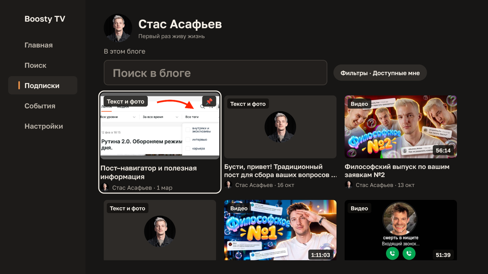
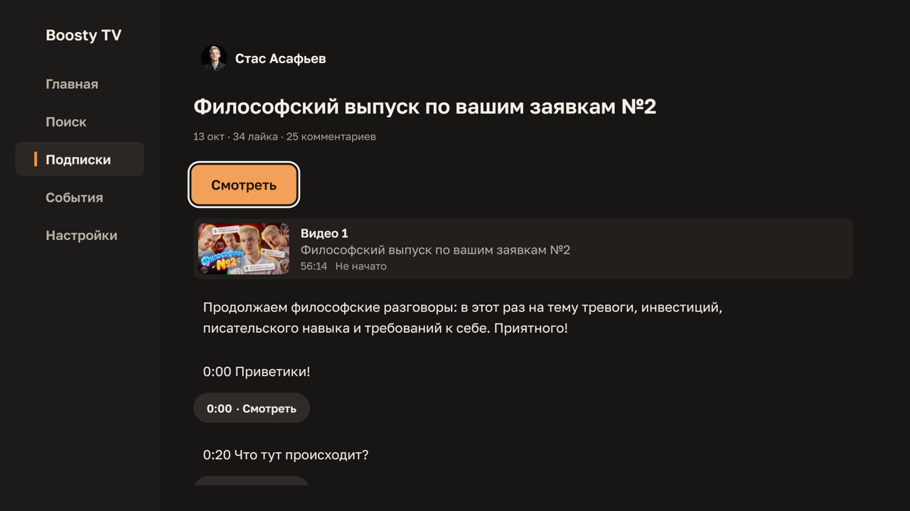

# Boosty TV

[Русская версия](README.md)

Independent, unofficial Boosty client for Android TV / Google TV, built with
React Native ([react-native-tvos](https://github.com/react-native-tvos/react-native-tvos)).
"Boosty TV" is a working title, not approved branding. Apple TV (tvOS) is out
of scope.

This project is not affiliated with or endorsed by Boosty. It uses the
unofficial Boosty API and shows only content the signed-in account is entitled
to; it does not bypass paywalls or DRM. The app interface is in Russian.

## Features

- Sign-in with a phone number and a one-time code, entirely with the remote.
- Subscriptions, a feed with access, period and tag filters, author pages with
  search, search across subscriptions.
- Posts: text, images with a full-screen viewer, links, files, audio, video,
  polls with voting, comments (read-only).
- Player: quality and speed selection, chapters, resume, a «Продолжить просмотр»
  (Continue watching) row, live streams and an «События» (Events) section.
- In-app updates: Settings → «Версия».





## Installation

1. Download the APK of the latest release from
   [Releases](https://github.com/dzmitryafanasenka/boosty-tv/releases/latest):
   `boosty-tv-<version>.apk` works on any device; the files with an ABI in the
   name are smaller (`arm64-v8a` for most TVs).
2. Install it on the TV, for example with `adb install boosty-tv-<version>.apk`
   or a file manager with installation from unknown sources allowed.
3. Later versions install from the app itself; the session and progress are
   kept.

Changes in every version are listed in [CHANGELOG.md](CHANGELOG.md).

## Contributing

Bug reports and ideas are welcome as GitHub issues. Code contributions are not
accepted: pull requests from outside the project are closed automatically. See
[CONTRIBUTING.md](CONTRIBUTING.md) and, for vulnerabilities,
[SECURITY.md](SECURITY.md).

## For developers

Project rules live in [`CLAUDE.md`](CLAUDE.md). Audit and planning documents
live in [`docs/`](docs) and [`_bmad-output/`](_bmad-output).

### Stack

- `react-native` aliased to `npm:react-native-tvos@0.87.1-1` (React 19.2.3), see
  [ADR 0001](docs/adr/0001-react-native-tvos-0-87-bootstrap.md).
- TypeScript (strict), Jest with `@react-native/jest-preset` and `test-renderer`,
  ESLint 8 with `@react-native/eslint-config` and `eslint-plugin-boundaries`.
- npm with exact pins and a committed `package-lock.json`. Node 24.
- Android only: `android/`. There is no `ios/` or tvOS target.

### Prerequisites

Exact versions and the machine setup are recorded in
[`docs/testing.md`](docs/testing.md).

- Node 24 (`.nvmrc`), npm 11
- JDK 17 (`JAVA_HOME`)
- Android SDK with platform 36/37, build-tools 36/37, NDK 27.1.12297006
  (`ANDROID_HOME`)

### Commands

```sh
npm ci                # install exact versions from the lockfile
npm run lint          # ESLint, including architecture boundaries
npm run typecheck     # tsc --noEmit
npm test              # Jest
npm start             # Metro dev server
npm run android       # build and install the debug app on a connected device

cd android && ./gradlew assembleDebug   # debug APK
```

### Source layout

```text
src/app/          composition, providers, navigation
src/features/*    one folder per feature; cross-feature imports only via index.ts
                  and only along allowlisted edges (post -> polls, post -> player)
src/shared/*      api, entities, services, filters, platform, focus, ui, i18n, storage
src/test/fixtures sanitized API responses
```

`.eslintrc.js` enforces the boundaries; `__tests__/boundaries.test.js` proves
they reject forbidden imports.

### Security

No keystores, signing configs, tokens or `.env` files are committed. Debug
builds use the local Android SDK debug keystore; release builds are signed by
the owner locally.

## License

[MIT](LICENSE) © 2026 Dzmitry Afanasenka
