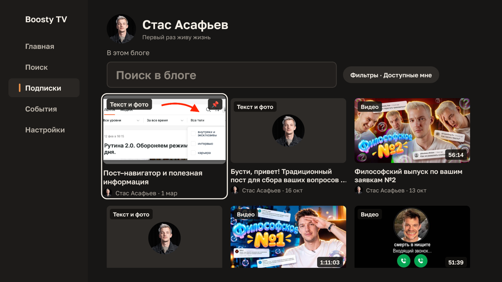
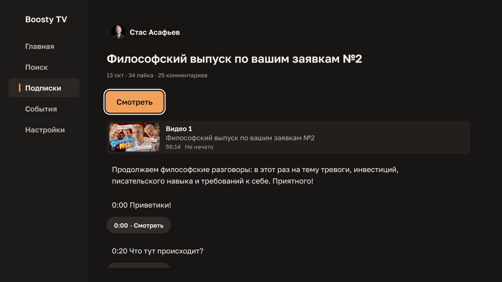

# Boosty TV

[English version](README.en.md)

Независимый неофициальный клиент Boosty для Android TV / Google TV на React Native
([react-native-tvos](https://github.com/react-native-tvos/react-native-tvos)).
«Boosty TV» — рабочее название, а не утверждённый бренд. Apple TV (tvOS) не
поддерживается.

Проект не связан с Boosty и не одобрен им. Он использует неофициальный API Boosty
и показывает только тот контент, к которому у вошедшего аккаунта есть доступ;
платный доступ и DRM не обходятся.

## Возможности

- Вход по номеру телефона и коду, полностью с пульта.
- Подписки, лента с фильтрами по доступу, периоду и тегам, страницы авторов с
  поиском, поиск по подпискам.
- Посты: текст, изображения с полноэкранным просмотром, ссылки, файлы, аудио,
  видео, опросы с голосованием, комментарии (только чтение).
- Плеер: выбор качества и скорости, главы, продолжение с места остановки,
  строка «Продолжить просмотр», эфиры и раздел «События».
- Обновление из приложения: Настройки → «Версия».





## Установка

1. Скачайте APK последнего релиза со страницы
   [Releases](https://github.com/dzmitryafanasenka/boosty-tv/releases/latest):
   `boosty-tv-<версия>.apk` подходит для любого устройства, файлы с ABI в
   названии меньше по размеру (для большинства ТВ — `arm64-v8a`).
2. Установите его на ТВ, например через `adb install boosty-tv-<версия>.apk` или
   файловый менеджер с разрешённой установкой из неизвестных источников.
3. Следующие версии устанавливаются из самого приложения; вход и прогресс
   сохраняются.

Что изменилось в каждой версии — в [CHANGELOG.ru.md](CHANGELOG.ru.md).

## Как помочь проекту

Об ошибках и идеях пишите в GitHub Issues. Изменения в код со стороны не
принимаются: pull request'ы от сторонних авторов закрываются автоматически.
Подробнее — в [CONTRIBUTING.md](CONTRIBUTING.md), об уязвимостях — в
[SECURITY.md](SECURITY.md).

## Для разработчиков

Правила проекта — в [`CLAUDE.md`](CLAUDE.md). Аудит и документы планирования —
в [`docs/`](docs) и [`_bmad-output/`](_bmad-output); техническая документация
написана на английском.

### Стек

- `react-native` — псевдоним `npm:react-native-tvos@0.87.1-1` (React 19.2.3), см.
  [ADR 0001](docs/adr/0001-react-native-tvos-0-87-bootstrap.md).
- TypeScript (strict), Jest с `@react-native/jest-preset` и `test-renderer`,
  ESLint 8 с `@react-native/eslint-config` и `eslint-plugin-boundaries`.
- npm с точными версиями и закоммиченным `package-lock.json`. Node 24.
- Только Android: `android/`. Целей `ios/` и tvOS нет.

### Требования

Точные версии и настройка машины — в [`docs/testing.md`](docs/testing.md).

- Node 24 (`.nvmrc`), npm 11
- JDK 17 (`JAVA_HOME`)
- Android SDK с platform 36/37, build-tools 36/37, NDK 27.1.12297006
  (`ANDROID_HOME`)

### Команды

```sh
npm ci                # установить точные версии из lockfile
npm run lint          # ESLint, включая границы архитектуры
npm run typecheck     # tsc --noEmit
npm test              # Jest
npm start             # dev-сервер Metro
npm run android       # собрать и установить debug-версию на подключённое устройство

cd android && ./gradlew assembleDebug   # debug APK
```

### Структура исходников

```text
src/app/          композиция, провайдеры, навигация
src/features/*    по папке на функцию; импорты между функциями только через index.ts
                  и только по разрешённым связям (post -> polls, post -> player)
src/shared/*      api, entities, services, filters, platform, focus, ui, i18n, storage
src/test/fixtures обезличенные ответы API
```

Границы проверяет `.eslintrc.js`; `__tests__/boundaries.test.js` доказывает, что
запрещённые импорты отклоняются.

### Безопасность

В репозитории нет keystore, конфигураций подписи, токенов и файлов `.env`.
Debug-сборки подписываются локальным debug keystore из Android SDK, релизные
сборки владелец подписывает локально.

## Лицензия

[MIT](LICENSE) © 2026 Dzmitry Afanasenka
