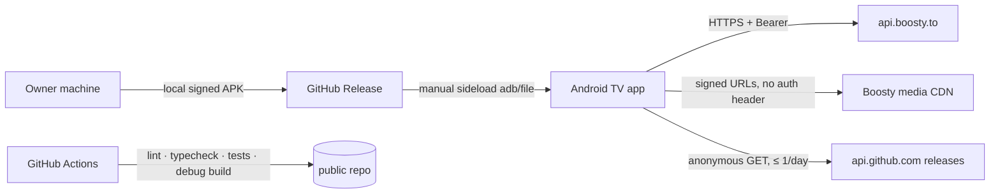

# Architecture Spine — Boosty TV

## Design Paradigm

**A feature-sliced layered app with ports and adapters at the platform edge.**

- **Features** are vertical slices. Inside a slice, dependencies go one way: **Screen → feature hook → repository → API client / platform port**.
- **Shared entities** (Post, Media, Author, Poll, Live stream) are owned once in `shared/entities` and reused by every feature.
- **Platform specifics** sit behind ports. The Android adapters implement them.

```mermaid
flowchart TD
  App[src/app: routes · shell · modal host · phase flags · bootstrap]
  subgraph F[src/features/*]
    S[Screens] --> H[Feature hooks]
    H --> FR[Feature repositories]
    S -. public index.ts widgets .-> OF[Other feature, allowlisted edge only]
  end
  subgraph SH[src/shared]
    ENT[entities: repositories + mappers for Post/Media/Author/Poll/Stream]
    API[api: HttpClient · AuthApiClient · SessionManager · AppError · queryKeys · dto]
    SVC[services: AccountScope · ProgressRepository · PlaybackArbiter · FocusRestoration · Logger · UpdateChecker]
    FIL[filters: model · store · panel]
    UI[ui · focus · i18n]
    PORT[platform ports]
  end
  ADP[shared/platform adapters]
  App --> S
  H --> ENT
  H --> SVC
  H --> FIL
  FR --> API
  ENT --> API
  SVC --> API
  SVC --> PORT
  API --> PORT
  PORT -. implemented by .-> ADP
```

Arrows mean "may import". `shared` never imports `features` or `app`. Features never import `app`.

## Invariants & Rules

### AD-1 — Layer and dependency direction [ADOPTED]

- **Binds:** all
- **Prevents:** HTTP calls, DTO parsing or token handling in screens; uncontrolled coupling between features.
- **Rule:**
  - Screens use only hooks, `shared/ui`, `shared/focus` and `shared/filters`.
  - Only repositories, in `shared/entities` or in a feature, call API clients.
  - A feature may import another feature **only through that feature's `index.ts`**, and only along these allowlisted edges:
    - `post → polls` (poll widget);
    - `post → player` (audio block widget only).
  - Navigation between features never uses imports; it goes through AD-17 routes.
  - All of this is enforced in CI with `eslint-plugin-boundaries`.

### AD-2 — Platform ports [ADOPTED]

- **Binds:** NFR-8, FR-3, FR-6, FR-35, FR-39, FR-42–51, FR-56
- **Prevents:** Android specifics leaking into features.
- **Rule:**
  - The ports are TypeScript interfaces in `shared/platform`:
    - `SecureStore`;
    - `KeyValueStore` (scoped `device` or `account`);
    - `PlayerEngine` (contract around react-native-video; positions cross the port in **integer seconds**);
    - `AppLifecycle`;
    - `ExternalPlayer`;
    - `QrRenderer`.
  - The implementations live in `shared/platform/android`.
  - No feature imports an adapter or a native module directly.
  - *As built (Epic 8 retro A2; superseding the two lines above):* there is no `shared/platform/android`. Ports and adapters are flat files in `src/shared/platform`. Some share one file (`appInfo.ts`, `deviceId.ts`, `externalPlayer.ts`, `logFile.ts`, `seekKeys.ts`, `secureStore.ts`, `qrRenderer.tsx`, `playbackArbiter.ts`); some are split (`keyValueStore.ts` / `asyncKeyValueStore.ts`, `playerEngine.ts` / `PlayerEngineView.tsx`); `appLifecycle.ts` wraps `AppState`. Only `shared/platform` touches `NativeModules` (`appInfo`, `deviceId`, `externalPlayer`, `logFile`, `seekKeys`, `secureStore`). Features import these platform modules directly (the preference stores use `asyncKeyValueStore`; `PlayerScreen` and `AudioBlock` use `PlayerEngineView`; `SettingsScreen` `getVersionName`; `usePlayerKeys` and `AudioBlock` `seekKeys`; `ExternalHandoff` the ExternalPlayer port; `DiagnosticsScreen` `logFileLocation`), so the effective rule is: no feature touches `NativeModules`, intents or `AppState` directly. `src/shared/services/logFileSink.ts` flushes on background through `appLifecycle.subscribeAppBackground` (Epic 8 retro A5; it used `AppState` directly before). Error contracts are per port and documented in each file. `externalPlayer` maps every failure to an outcome: `prepare` → `'ready' | 'none'`, `launch` → `'opened' | 'none'`. `logFile`'s `append` rejects (also when the module is missing); `clear` rejects on a failed delete and resolves when the module is missing; `location()` never rejects (null when there is no module or storage).

### AD-3 — Session ownership

- **Binds:** FR-1–8, NFR-1, NFR-3
- **Prevents:** tokens in UI state; several refresh paths; a false "Сессия истекла" while offline.
- **Rule:**
  - **SessionManager** (`shared/api`) is the only reader and writer of tokens, through `SecureStore`.
  - **Entry points:** `signIn(tokens)` (called by auth after a successful confirm) and `signOut()`.
  - **Token use:** `HttpClient` gets the token from SessionManager.
  - **Refresh** is single-flight, with one shared promise:
    - proactive when fewer than 300 s remain;
    - once after a 401, after which the original request is retried once.
  - **Status becomes `expired` only when the refresh endpoint *rejects* the refresh token** (a 4xx confirmed in spike S4).
    - On `Network` or `Server` errors the tokens are kept, the status stays `signedIn`, and the triggering request fails with that kind.
  - **What UI sees:** only `status: signedOut | signedIn | expired`. Zustand is never used for tokens.
  - **SecureStore corruption:** reading a corrupted store yields `signedOut` after the store is wiped, with a «Войдите снова» message. It never crashes.

### AD-4 — Account scope

- **Binds:** FR-6, FR-7, FR-8, FR-15, FR-54
- **Prevents:** cross-account leaks, including late async writes.
- **Rule:**
  - Every account-scoped store registers with `AccountScope` **at bootstrap** in `app/bootstrap.ts`. Lazy registration is not allowed.
  - **Account-scoped data:** the query cache, the Continue history, Filters, the stored phone, the account id and the diagnostics log buffer.
  - **Device-scoped data:** `device_id`, preferred quality, preferred speed, the «Системный видеоплеер» toggle and the «Запись логов» toggle. The four preferences are built on `createDevicePreference` (below).
  - *As built (Epic 8):* the device-scoped keys in `boostytv-device` are `player.quality.v1`, `player.speed.v1` (Story 8.1), `player.external.v1` («Системный видеоплеер», Story 8.2) and `diagnostics.capture.v1` (Story 8.3). None is registered with AccountScope. The diagnostics log file is account-scoped (`logFile` store, right after `logger`); only when a log file exists and its delete fails, the reset reports the store as failed and `accountSwitchHook` throws, so the new sign-in fails as spent and nothing of the new account is stored (fail-closed on purpose: the file may hold the old account's lines). Sign-out does not fail on it. The store is registered whatever `phaseFlags.diagnostics` says.
  - *As built (Epic 8 retro A3):* every device preference is a definition (key, parse, serialize, fallback, log scope and label) on one factory, `createDevicePreference` (`src/shared/storage/devicePreference.ts`): one read per app run, single-flight, a pick during the read wins, `write` updates memory first and stores in the background, failures only log a warning. One setter, `setDevicePreferenceKeyValueStore`, replaces the device store for all of them; only the demo calls it (`src/app/session.ts`). `remember` (memory only) exists only on a definition with `rememberable: true` (quality). A throwing `onValue` is only logged. Screens read them through `usePreference`, a single-consumer snapshot hook (no subscription: it copies the value at mount or when the store changes, then follows only its own reads and writes). The «Запись логов» preference lives in `src/shared/services/diagnosticsCapture.ts` and applies each value to `logFileSink`. Directory edges: `shared/storage → shared/platform` and `shared/storage → shared/services/logger`; `shared/services/diagnosticsCapture → shared/storage`. No module imports back, so there is no cycle. A new device value uses the factory, never a copied store.
  - `AccountScope.reset()` is the only cleanup path, used on sign-out and on account switch. It increments a **generation**. Any async write (E9, history, cache set) captures the generation when it starts and is **dropped** if the generation has changed.
  - On account switch (`E1.id` differs), the reset happens **before** the new phone and account id are written.
  - *As built (Epics 5–7):* the registered stores also include FocusRestoration, the sign-in draft, the Поиск query (`searchQuery`, Story 5.6) and the События read marks (`eventReadMarks`, Story 7.5) (`src/app/bootstrap.ts`).
  - **Exception: generation-keyed module state** (Epic 6 retro A5, Epic 7 retro A2/A3). Two single-flight and optimistic stores are module-level and are **not** registered with AccountScope: `usePollVote`'s in-flight entries (Story 6.6) and `useLiveLike`'s optimistic overlays (Story 7.4). Both use `createGenerationKeyedStore` (`src/shared/account/generationKeyed.ts`).
    - Every entry is keyed `<generation>:<id>`, so after a reset the next account never sees or waits on an old entry.
    - A late result of the old account can only touch its own entry, and it writes nothing to the cache.
    - New module-level state of this kind uses the same helper, never an ad-hoc map.

### AD-5 — Error taxonomy

- **Binds:** NFR-2, all screen states, FR-1–2
- **Prevents:** a 403 treated as an expired session; per-feature error handling.
- **Rule:**
  - Errors are built only in `shared/api`, as `AppError.kind`:

    | Kind | Covers |
    | --- | --- |
    | `SessionExpired` | Session can no longer be refreshed |
    | `NoAccess` | Content not available to this account |
    | `MediaUrlExpired` | Signed media URL no longer valid |
    | `NotFound` | Content does not exist |
    | `RateLimited` | Too many requests |
    | `Client` | Any other or unverified 4xx |
    | `Server` | 5xx |
    | `Network` | No connection or transport failure |
    | `Parse` | Response failed validation |

  - The auth client additionally maps to `AuthError.kind`:

    | Kind | Covers |
    | --- | --- |
    | `InvalidPhone` | Phone number rejected |
    | `WrongCode` | Code does not match |
    | `CodeExpired` | Code no longer valid |
    | `TooManyAttempts` | Attempt limit reached |
    | `VerificationRequired` | Captcha or extra check required |
    | `Unknown` | Anything unverified |

  - Only response shapes verified in `api-contract.md` map to specific kinds. Everything else maps to `Client`, `Server` or `Unknown`.
  - Screens choose state and copy (`error.<kind>`) by kind only, never by HTTP status.
  - *Accepted exception (Epic 6 retro A5):* a failed poll vote or retract shows one inline line per mutation (`vote` / `retract`), whatever its `AppErrorKind` (`src/features/polls/usePollVote.ts`). A live failure was never provoked. The live like (Story 7.4) keeps the kind.

### AD-6 — Retry and mutation policy

- **Binds:** NFR-3, FR-23, FR-24, FR-41, FR-44, FR-57
- **Prevents:** duplicate votes and likes; retry storms.
- **Rule:**

  | Kind | GET | Mutation |
  | --- | --- | --- |
  | Network | ≤ 2 retries, exponential backoff | none |
  | Server | ≤ 1 retry | none |
  | RateLimited | none automatically (user «Повторить») | none |
  | Client, NotFound, NoAccess, Parse | none | none |

  - Mutations (E11, E12, E16, E17) allow one request in flight per entity.
  - E9 may be re-sent, but only with the latest position.

### AD-7 — Server state

- **Binds:** FR-13–41, FR-57
- **Prevents:** duplicate cache entries; stale entities after mutations; refetch loops.
- **Rule:**
  - **TanStack Query only.** Keys come only from `shared/api/queryKeys.ts`. Scopes never collide (for example, `search` and `author` keys are disjoint).
  - **Lists:** `useInfiniteQuery` with the opaque `offset`; pages are deduplicated by id.
  - **Polls** have a single source: the `poll` inside cached Posts. After a vote, the E10 result is written by one helper, `entities/poll.applyPoll(pollId, poll)`, into every cached post and page containing that poll. There is no separate poll key.
  - **Live stream:** `['stream', blogUrl]`, owned by `entities/stream`. The player invalidates it when a stream ends.
    - *As built (Stories 7.1–7.2):* the Author page reads it with `staleTime: 0`, so every open sends one E15, and with `retry: false`.
    - **E15 polling:** it is refetched every 30 s while the Author route is focused, the app is in the foreground and a live or scheduled card is shown (`LIVE_POLL_INTERVAL_MS`, `src/features/author/useAuthorLive.tsx`; owner decision 2026-10-30 Q1 a).
    - Leaving the live player by any path invalidates it (`src/app/stackRoutes.tsx`).
    - Signed live URLs live under their own key root, with no structural sharing and a short `gcTime`. They are never refetched by a resume.
  - **Events:** `['events']` (Story 7.5), one E18 request with `staleTime: 0`.
  - **Defaults:** `staleTime` 60 s, `gcTime` 10 min, and no focus-based refetch. `AppLifecycle` resume invalidates the visible list silently (focus is kept).
    - *As built (ADR 0010, `src/app/App.tsx`):* resume never invalidates a paged list, because a refetch of an infinite query reloads every loaded page. Instead, after the resume E1 succeeds:
      - Главная's feed and every observed `authorPosts` query get a **head refresh**: one page-1 request when the list is at least 60 s old, merged into the head (`refreshPostsHead`).
      - `allStreams()` and `events()` are **invalidated**, so only observed queries refetch.
    - Подписки, Поиск results and Пост are not refreshed on resume.
    - The feed query sets `refetchOnMount: false`. «Обновить» (Story 5.1) is a forced head refresh plus an E2 invalidation.

### AD-8 — Boundary parsing and shared entities

- **Binds:** NFR-4, FR-38, all features reading Posts
- **Prevents:** one DTO mapped several different ways.
- **Rule:**
  - Each DTO has exactly one Zod 4 schema (`shared/api/dto`) and one mapper (`shared/entities/*/mapper.ts`).
  - Post, Media, Author, Poll and Stream are fetched only through the `shared/entities` repositories (E3–E8, E10, E15). Features add hooks, never their own copy of these calls.
  - Unknown blocks become `Block.Unknown`. A malformed item is dropped and logged, never failing the whole page.
  - Domain types carry no raw DTO fields and do **not** expose `timeCode`. Progress is read only via AD-10.
  - *As built:* mappers are named after their entity (`mapPost.ts`, `mapAuthor.ts`, `mapPoll.ts`, `mapStream.ts`, `mapEvents.ts`), not `mapper.ts`.
  - **Entity → entity edges (as built):**
    - `entities/post` → `entities/poll`: a Post carries its Poll, and `mapPost` uses `mapPoll` (Story 6.5).
    - `entities/stream` → `entities/post/videoSources` (Epic 7 retro, accepted): `liveSources.ts` and `streamRepository.ts` pick live-edge `playerUrls` with the same rules as VOD.
    - Both are one-way. Neither poll nor post imports stream, and poll does not import post. A new edge between entities is recorded here.

### AD-9 — Identity and references

- **Binds:** FR-11, FR-13, FR-15, FR-33, FR-44
- **Prevents:** progress or focus keyed by index or URL; signed URLs in navigation state.
- **Rule:**
  - Keys are `post.id`, `blogUrl` and media `id`.
  - A playable item is always referenced as `MediaRef {blogUrl, postId, mediaId}`, or `LiveRef {blogUrl}`.
  - Signed `playerUrls` and `signedQuery` are transient. They are never persisted, never put in route params and never used as keys.

### AD-10 — Progress ownership

- **Binds:** FR-14, FR-15, FR-33, FR-43, FR-44, FR-49, FR-51
- **Prevents:** the player, post and Главная disagreeing; write storms.
- **Rule:**
  - **ProgressRepository** (`shared/services`) is the only writer of E9 and of the Continue history, and the only reader of `timeCode`.
  - **Player API:**
    - `begin(ref: MediaRef, meta {title, postTitle, authorName, previewUrl, durationSec})` at playback start;
    - `report(ref, positionSec, event)` afterwards.
  - **Writes:** at most one write per ≥ 10 s of movement, plus forced writes on pause, background, exit and end. Positions are integer seconds.
  - **`resumePoint(ref)`:** the local position if a local entry exists (owner decision), otherwise the server `timeCode`.
  - **Finished** is computed only here: ≥ 95 % or < 30 s left, using `durationSec`.
  - **UI reads progress only through `useProgress(ref)`.**
  - **On `SessionExpired`:** a pending write is held, then flushed after re-login only if the generation is unchanged (AD-4).

### AD-11 — Media resolution

- **Binds:** FR-22, FR-42, FR-46, FR-48
- **Prevents:** forwarded CDN auth; several recovery strategies.
- **Rule:**
  - `MediaResolver` (player feature) resolves `MediaRef | LiveRef` plus the preferred quality into a source, using the entity repositories (E8 / E15).
  - Recovery runs once automatically, then waits for the user.
  - The Authorization header is attached only to `api.boosty.to`. CDN and GitHub calls never get it.

### AD-12 — Focus identity and restoration

- **Binds:** FR-10, FR-11, FR-12
- **Prevents:** per-screen restoration logic; two writers of the return target.
- **Rule:**
  - Focus IDs follow `<screen>/<zone>/<id>`.
  - **FocusRestoration** is the single store of `{focusId, scrollOffset}`, keyed by **route key + section id**, so each sidebar section keeps its own memory.
  - Only FocusRestoration decides the return focus. Other code may only call `setReturnFocus(routeKey, focusId)` — for example, the player after FR-49, pointing at the next unfinished media row.
  - Native focus only. D-pad handlers are allowed only in the player, the period stepper and the audio block.
  - **`docs/focus-map.md`** (English) must exist before the first UI story starts.
  - *As built (Epic 3 retro, accepted):*
    - On stack screens the screen segment carries the route's entity (`author/<blogUrl>/post/<postId>`, `post/<postId>/…`). `docs/focus-map.md` §1 lists every id.
    - `setReturnFocus` is a Shell section callback, used by every Shell section (Главная, Поиск, Подписки, События; ADR 0012), not `setReturnFocus(routeKey, focusId)`. The player writes its return target through `focusRestoration.remember`.
    - Пост keeps its own column focus memory, a deliberate deviation explained in `docs/focus-map.md` §1.6.

### AD-13 — Navigation model

- **Binds:** FR-9, FR-10
- **Prevents:** competing Back handling and section/stack confusion.
- **Rule:**
  - **Root:** one React Navigation JS stack (`@react-navigation/stack`, ADR 0007), with screens Auth*, Shell, Author, Post, Player and SessionExpired. Each screen traps D-pad focus and restores its return focus explicitly.
  - **Shell:** owns the sidebar and swaps section content *in place*. Sections are not stack entries.
  - **Back order:**
    1. the modal host (keyboard, dialog, sheet, QR);
    2. the stack;
    3. in Shell: content → sidebar → Главная → exit.
  - **Overlays** render in one modal host.
  - **Route params are ids and refs only** (AD-9). Routes are declared once in `app/routes.ts` (AD-17).

### AD-14 — Secrets, diagnostics and platform hardening

- **Binds:** NFR-1, FR-1, FR-6, FR-54, FR-56
- **Prevents:** secrets or personal data reaching logs, backups, fixtures or the public repo.
- **Rule:**
  - Only SecureStore holds tokens and the phone.
  - **Logger** redacts the following before anything is written to its buffer:
    - tokens and cookies;
    - Authorization headers;
    - phone numbers and codes;
    - signed URLs and `signedQuery`.
  - The buffer is an in-memory ring plus one capped file in internal storage. It is account-scoped and exportable only via adb.
  - *As built (Story 8.3, owner decision):* the file is in app-specific external storage (`getExternalFilesDir(null)/logs/boostytv.log`, 256 KB plus one rotated copy) so `adb pull` works on a release build; internal `filesDir` below API 29. Free-text redaction (`redact()`) also covers any `Authorization:` value, `Cookie:` / `Set-Cookie:`, bare `expires=`/`sig=` queries and secret query/JSON keys; it still blanks `code=`, `*_code=` (for example `version_code=1`) and `"code":` in message text, so a version code must go in a field, not the message. Field keys (`isSecretFieldKey`): token, cookie, authorization, signedquery, phone and challenge anywhere in the compact key; `code` only as a one-time or access code since Epic 8 retro A1; `challenge` is a field-key rule only (in free text a challenge is caught only by the 32+ character opaque-run rule). HTTP log paths (`logPath`, `src/shared/api/transport.ts`) drop the host, query and fragment, turn the segment after `/v1/blog/` into `<blog>` and every segment not in `API_WORDS` into `<seg>`. `__tests__/loggerFieldKeys.test.js` checks every logger call site's field keys.
  - Fixtures are sanitized, and a CI script checks them.
  - The Android manifest sets `allowBackup=false` and disables cleartext traffic.
  - Default TLS validation is never disabled.

### AD-15 — Fixture transport (demo mode and tests)

- **Binds:** NFR-9
- **Prevents:** mocks shipping as the real integration; divergent test mocks.
- **Rule:**
  - A single `FixtureTransport` replaces `HttpClient`'s network layer. It serves both the debug-only demo mode (a build flag that shows a persistent «ДЕМО» badge) and the integration tests.
  - A release build fails if the flag is on.
  - No other HTTP mocking library is used.

### AD-16 — Release and signing

- **Binds:** FR-55, FR-56
- **Prevents:** a signing key in the public repo or in CI.
- **Rule:**
  - CI (GitHub Actions) runs only lint, typecheck, tests and the debug build.
  - The owner builds and signs the release APK locally and attaches it to a GitHub Release tagged `v{versionName}`.
  - `UpdateChecker` uses its own unauthenticated client and compares against that tag.

### AD-17 — Routes and cross-feature composition

- **Binds:** FR-32, FR-33, FR-39–41, FR-57, FR-42, FR-21–22
- **Prevents:** features unable to embed or open each other, or each inventing its own route names and params.
- **Rule:**
  - `app/routes.ts` declares every route with typed params, for example:
    - `Post {blogUrl, postId}`;
    - `Player {ref: MediaRef | LiveRef, origin: {routeKey, focusId}}`;
    - `Author {blogUrl}`.
  - Features navigate only through these typed routes.
  - *As built:* `Author` and `Post` also take `section`, the origin Shell section that is the sidebar's current item (ADR 0012). It is an id, not a ref. The stack screens Автор and Пост keep the Shell sidebar through `StackSidebarRoute` (`src/app/stackRoutes.tsx`).
  - Embeddable widgets (PollWidget, AudioBlock) are exported from their feature's `index.ts` and used only along the AD-1 allowlist.

### AD-18 — Filter model

- **Binds:** FR-17, FR-26–31, FILTER-01..04
- **Prevents:** two filter stores; query keys that change every second.
- **Rule:**
  - The model is `Filter {access: 'allowed'|'all'|'bought', period: {kind:'all'} | {kind:'preset', days} | {kind:'custom', fromDay, toDay}, tagIds: string[]}`.
  - The period stays **symbolic** in state and in query keys. Repositories resolve it to `from_ts`/`to_ts` (local day bounds) at request time.
  - One Zustand `filtersStore` in `shared/filters` holds a Filter per scope: `feed`, `search` or `author:<blogUrl>`.
  - The store is in memory and account-scoped. It survives re-login of the same account but not an app restart.
  - The filter panel UI lives in `shared/filters`.
  - *As built (Stories 5.5, 5.7; `src/shared/filters/filter.ts`):*
    - Tags are `tags: readonly {id, title}[]` in selection order. Keys and `tags_ids` use the sorted ids only.
    - **The Author scope is per route:** `author:<routeKey>`, not `author:<blogUrl>` (owner decision 2026-10-29 Q3 b). A fresh Author route starts at the default, and the scope is reset when the route unmounts, so two Author routes of one blog never share a Filter.
    - The Author access values are only `allowed` (the default, Q2 a) and `all`, because E4 ignores `only_bought=true` (A a).
    - Blog search under `allowed` drops `hasAccess: false` results on the client, because E7 ignores the access params (B a).

### AD-19 — Single active playback

- **Binds:** FR-39, FR-42, FR-22
- **Prevents:** audio continuing under video, or two players fighting over audio focus.
- **Rule:**
  - `PlaybackArbiter` (`shared/services`) grants a single playback slot, for audio or video.
  - Claiming the slot stops the current holder.
  - The audio block releases the slot when its post unmounts.
  - Audio-focus loss reported by `AppLifecycle` pauses the holder.

### AD-20 — Phase gating

- **Binds:** FR-9, FR-53, all phase tags
- **Prevents:** dead-end UI for features from later phases.
- **Rule:**
  - One `app/phaseFlags.ts` maps each capability to the phase that enables it.
  - Sidebar sections and in-screen entry points (filter chip, speed, «Мой блог», live card, search) are rendered only when their flag is on.
  - No screen hard-codes the phase.

## Consistency Conventions

| Concern | Convention |
| --- | --- |
| Naming | Folders `kebab-case`. Components `PascalCase.tsx`. Hooks `useX.ts`. Repositories `xRepository.ts`. DTO schemas `XDto`. Domain names follow the PRD Glossary verbatim. |
| IDs | `postId`, `mediaId` and `pollId` are strings in the domain. `blogUrl` is the Author key. |
| Time | Domain timestamps are epoch **ms**. Playback positions and durations are integer **seconds** everywhere above `PlayerEngine`. API `*_ts`, E9 and `timeCode` are converted in repositories. |
| Errors | `AppError.kind` / `AuthError.kind`. Copy comes from `error.<kind>` in the i18n catalog. |
| State | Server state lives in TanStack Query. Session status lives in SessionManager. Filters live in `filtersStore`. Progress lives in ProgressRepository. Everything else is local React state. |
| Config | `app/appConfig.ts` holds the hosts, the update repo and the demo flag. `app/phaseFlags.ts` holds phases. Nothing is hardcoded elsewhere. |
| i18n | Typed `ru` catalog. A hand-written Russian plural selector (Hermes has no `Intl.PluralRules`). No literals in components. |
| External URLs | `shared/entities/externalUrls.ts` builds every QR target (stream page, file, link, release page). |
| Design | DESIGN.md tokens in `shared/ui/tokens.ts`. No raw colors or sizes in components. |
| Lists and images | `FlatList` with `getItemLayout` and React Native `Image` for v1. FlashList is considered only if P3 measurements need it. *As built (ADR 0011, owner decision 2026-10-26, Story 3.1 device profiling):* `@shopify/flash-list` 2.3.3 for the post grids (`PostGrid`: Главная, Автор, Поиск), Подписки and События. Grids are rows of 3, with a fixed row height and no `getItemLayout` in v2. The filter tag list stays a `FlatList`. |
| Tests | Jest with `@react-native/jest-preset`, plus @testing-library/react-native and its `test-renderer` peer. Integration tests use FixtureTransport. Each mapper has fixture tests. |
| Android | New Architecture only (RN ≥ 0.82). Variants: `debug` (demo allowed) and `release`. TV manifest: `LEANBACK_LAUNCHER`, banner, `touchscreen required=false`. `minSdk` as set by the 0.87.1 template. |

## Stack

| Name | Version |
| --- | --- |
| react-native → `npm:react-native-tvos` | 0.87.1-1 (exact pin; react 19.2.3) |
| Bootstrap | `@react-native-community/cli init --version 0.87.1`, then alias `react-native` to `react-native-tvos@0.87.1-1` [ASSUMPTION: exact steps confirmed in spike step 1] |
| TypeScript | ^6.0.3 (from the 0.87.1 template), strict |
| Jest / @react-native/jest-preset | ^29.6.3 / 0.87.x (template) |
| @testing-library/react-native / test-renderer | 14.1.x / 1.3.x |
| @react-navigation/native / stack (JS stack) | 7.5.x / 7.12.x (ADR 0007: `detachInactiveScreens={false}`, focus trap per screen, explicit focus restoration; native-stack dropped after the Story 1.2 device defect) |
| react-native-gesture-handler | 3.4.x (required peer of the JS stack; gestures disabled) |
| react-native-screens / react-native-safe-area-context | 4.30.x (peer of the JS stack only; its views are not rendered, ADR 0007) / 5.10.x |
| react-native-video | 6.19.x (v6 support line; v7 is in beta) |
| Secure storage (Android) | react-native-keychain 10.0.0 + native storage-reset helper behind `SecureStore` (ADR 0006; verification gate in Story 1.3; fallback: own Keystore module) |
| @react-native-async-storage/async-storage | 3.1.x (`createAsyncStorage` API) |
| @tanstack/react-query | 5.104.x |
| zod | 4.6.x (Hermes release build verified in Story 1.2; JIT works, jitless not needed; needs `@babel/plugin-transform-export-namespace-from` in `babel.config.js`) |
| zustand | 5.0.x |
| react-native-qrcode-svg / react-native-svg | 6.3.x / 15.16.x (as built: pinned 6.3.26 / 15.15.5, `package.json`; ADR 0013, ADR 0014) |
| @shopify/flash-list | 2.3.3 (ADR 0011; added in Story 3.1) |
| eslint-plugin-boundaries | 7.3.x (ESLint version as set by the template) |
| Package manager / runtime | npm with package-lock.json; Node 24 |
| Font | Golos Text (bundled) |

Versions were checked on npm on 2026-10-25 (see `reviews/review-versions.md`). Compatibility on the device is confirmed in spike step 1. Any fallback gets an ADR in `docs/adr/`.

## Structural Seed

```text
src/
  app/            # bootstrap (AccountScope registrations), routes.ts, Shell, modal host, appConfig, phaseFlags
  features/
    auth/         # phone/code, session expired, sign-out
    home/         # Главная: continue row + feed
    subscriptions/
    author/       # author page, live card
    search/
    post/         # post screen, blocks, QR chips
    polls/        # PollWidget (exported via index.ts)
    player/       # player screen, MediaResolver, live heartbeat, AudioBlock (exported)
    events/       # gated (E18)
    settings/     # settings, diagnostics, update notice
  shared/
    api/          # HttpClient, AuthApiClient, SessionManager, AppError/AuthError, queryKeys, dto/
    entities/     # post, media, author, poll, stream: repositories + mappers; externalUrls
    services/     # AccountScope, ProgressRepository, PlaybackArbiter, FocusRestoration, Logger, UpdateChecker
    filters/      # Filter model, filtersStore, FilterPanel
    platform/     # ports; android/ adapters
    focus/ ui/ i18n/ storage/
  test/fixtures/  # sanitized API responses (FixtureTransport)
docs/adr/  docs/focus-map.md
```



- **Environments:** one production API. Debug builds may use FixtureTransport. There is no staging and no backend.
- **Operations:** the owner keeps it running manually, with diagnostics via adb. There is no telemetry and no crash reporting.

## Capability → Architecture Map

| Capability / Area | Lives in | Governed by |
| --- | --- | --- |
| Sign-in, session, sign-out, account switch (FR-1–8) | `features/auth`, `shared/api`, AccountScope | AD-3, AD-4, AD-5, AD-14 |
| Shell, Back, focus (FR-9–12) | `app/` Shell + routes, `shared/focus`, FocusRestoration | AD-12, AD-13, AD-20 |
| Feed, continue row, refresh, feed filters (FR-13–17) | `features/home`, `shared/entities/post`, ProgressRepository, `shared/filters` | AD-7, AD-8, AD-10, AD-18 |
| Subscriptions, author, live (FR-18–25) | `features/subscriptions`, `features/author`, `entities/stream`, `features/player` | AD-6, AD-7, AD-11, AD-17 |
| Search and filters (FR-26–31) | `features/search`, `shared/filters` | AD-7, AD-18 |
| Post, blocks, QR, audio (FR-32–39) | `features/post`, `features/player` (AudioBlock), QrRenderer | AD-8, AD-9, AD-17, AD-19 |
| Polls (FR-40, FR-41, FR-57) | `features/polls`, `entities/poll` | AD-6, AD-7 |
| Player (FR-42–51) | `features/player`, PlayerEngine, MediaResolver | AD-10, AD-11, AD-19 |
| Events (FR-52) | `features/events` | AD-8, AD-20 |
| Settings, diagnostics, update check (FR-53, 54, 56) | `features/settings`, Logger, UpdateChecker | AD-14, AD-16, AD-20 |
| Release (FR-55) | local build + GitHub Release | AD-16 |
| NFR-1 Security | SecureStore, Logger, manifest | AD-3, AD-14 |
| NFR-2 Error semantics | `shared/api` | AD-5 |
| NFR-3 Resilience | HttpClient, SessionManager | AD-3, AD-6 |
| NFR-4 Defensive parsing | `shared/api/dto`, `shared/entities` | AD-8 |
| NFR-5 Performance | lists, images | Conventions › Lists; Deferred |
| NFR-6 TV accessibility | `shared/ui`, `shared/focus` | AD-12, DESIGN.md |
| NFR-7 Localization | `shared/i18n` | Conventions › i18n |
| NFR-8 Platform boundaries | ports | AD-2 |
| NFR-9 Verification | tests, FixtureTransport, docs/testing.md | AD-15 |

## Deferred

- **Bootstrap details and device compatibility.** Spike step 1 confirms both. Each fallback gets an ADR:
  - own navigation stack instead of React Navigation (TV support is unofficial);
  - own Keystore module instead of react-native-keychain + reset helper, if the ADR 0006 gate fails;
  - Zod jitless mode.
- **Exact refresh-rejection status (AD-3)** and the **CDN expired-URL signal (AD-11)**: spikes S4 and S7.
- **Server `timeCode` round-trip:** spike S8. AD-10 already covers both outcomes.
- **Virtualization tuning and FlashList:** measured in P3. *FlashList itself was adopted early in Story 3.1 (ADR 0011). The P3 tuning stays deferred.*
- **Events paging:** after E18 is verified. *E18 was verified in Story 7.5. Its body has no cursor-like field, so only the first page is shown, and paging stays deferred.*
- **Crash reporting:** none in v1 (no telemetry). It needs owner approval.
